<p align="center">
  
</p>

<h1 align="center">Serifa<br><sub><sup><sup><sub>Copyright (©) 2026 Clara Portes</sub></sup></sup></sub></h1>

<p align="center">
  Editor de textos para escritores de livros e fanfics, com cara e jeito de Word. Organize cada história com nome e descrição, escreva capítulo por capítulo numa folha de verdade (A4, A5, Carta, Ofício, Livro 6×9", Bolso 5×8" ou B5, branca, marfim, pautada, quadriculada, antiga ou noturna), veja quantas palavras escreveu em tempo real, escolha entre mais de 90 fontes, use estilos feitos para fanfic (pensamento, flashback, mensagem de celular, carta e nota do autor), corrija a ortografia em português e receba um <b>balão de ideia</b> quando o tempo verbal foge do período ou a frase não faz sentido, e ligue ou desligue a correção e os balões a hora que quiser. No fim, exporte direto para o <b>Wattpad</b> ou o <b>AO3</b>, com as linhas em branco antes dos diálogos colocadas sozinhas, ou para Word, EPUB, PDF, HTML, Markdown e texto.<br>
  Roda de quatro maneiras: direto no navegador, sem baixar nada (<a href="https://violet-pixel.github.io/Fiction-Writing-Editor/">violet-pixel.github.io/Fiction-Writing-Editor</a>), como programa no Windows com o <code>Serifa.exe</code> (janela própria e uma pasta para cada história em Downloads), com dois cliques no <code>visualizar.bat</code> ou com o servidor local em Java, que traz a API.<br>
  Pronto para usar.
</p>

<p align="center">
  Java 21 (servidor, API e motor de revisão) · Go (versão para Windows) · JavaScript (módulos ES, Web Worker, CSS Custom Highlight API) · C (contador em WebAssembly) · C++ (distância de edição em WebAssembly e revisor de linha de comando) · HTML5 · CSS3 · IndexedDB · PostgreSQL 17 (opcional) · PowerShell · Node Test Runner · Playwright
</p>

---

> **Manual completo:** [`Manual-Serifa.pdf`](Manual-Serifa.pdf) explica, passo a passo, as três maneiras de abrir o Serifa, o tutorial de boas-vindas, Minhas histórias, cada guia da faixa de opções, capítulos, o painel do capítulo, as fontes e os estilos de texto, folhas e layout, os modos Livro, Wattpad e AO3, o corretor, o balão de ideias, o contador e a meta diária, como publicar no Wattpad e no AO3, a exportação, onde os textos ficam salvos, os atalhos e a solução de problemas (cópia em [`docs/`](docs/Manual-Serifa.pdf)).

> **Banco de dados:** [`Banco-de-Dados-Serifa.pdf`](Banco-de-Dados-Serifa.pdf) traz a arquitetura que o banco deve usar: PostgreSQL no servidor e IndexedDB no navegador, o diagrama de relacionamentos, todas as tabelas com campos, tipos, chaves e restrições, as revisões, a concorrência otimista, consultas prontas, backup e as regras de integridade e privacidade (cópia em [`docs/`](docs/Banco-de-Dados-Serifa.pdf)).

> **Versão 1.0.0 (Atual):** primeira versão pública, com tutorial na abertura, **Minhas histórias** (nome e descrição para cada história), capítulos fáceis de criar e organizar, painel do capítulo expansível, 91 fontes (77 embutidas) e 5 estilos de texto para fanfic, Serifa para Windows (`Serifa.exe`, abre maximizado e salva cada história numa pasta em Downloads), guia **Configurações** para escolher essa pasta, **importar uma pasta** de PDFs ou TXTs como história (com tela de verificação e aviso de formatos misturados), **exportar todos os capítulos em .zip** e a paleta de cores do Lume.

<p align="center">
  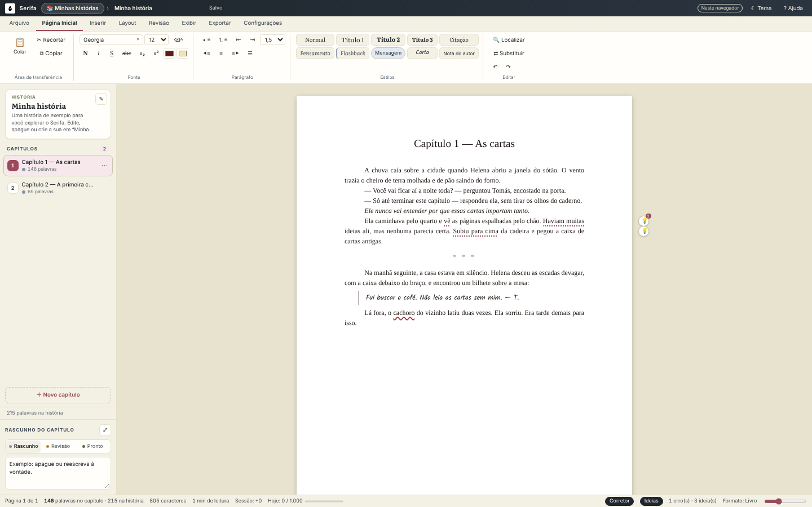
</p>

## O que o Serifa faz

- **Serifa para Windows:** dois cliques no `Serifa.exe` (13 MB, sem instalar nada) abrem o Serifa numa janela própria, **maximizada**. Ao criar uma história, nasce a pasta `Downloads\Nome da história`: o `.serifa` é gravado lá enquanto você escreve e cada exportação vai direto para lá, sem a janela de "salvar como". Fechar a janela não pergunta nada.
- **Configurações:** a guia **Configurações** mostra a pasta das histórias, deixa escolher outra (ou voltar para Downloads), abrir a pasta no Explorador e ligar ou desligar a pasta automática e o salvamento do `.serifa`.
- **Importar uma pasta:** escolha uma pasta com os capítulos em **PDF**, **TXT**, Markdown ou Word e o Serifa monta a história, um capítulo por arquivo, na ordem dos nomes. Antes, uma **tela de verificação** mostra cada arquivo para marcar ou desmarcar e renomear, com **aviso** se houver formatos diferentes misturados. O texto do PDF é lido com parágrafos e falas.
- **Capítulos em .zip:** a história inteira num `.zip`, com uma pasta com o nome da história e um arquivo por capítulo (`01 - O porto.docx`, `02 - …`), em Word, texto, Markdown, HTML ou no HTML do Wattpad e do AO3, com o `.serifa` junto se quiser.
- **Tutorial na abertura:** na primeira vez, uma tela de boas-vindas e um tour animado mostram cada parte do editor, destacando na tela onde clicar, com barra de progresso e atalhos de teclado. Dá para **pular** a qualquer momento (ou usar as setas e o Esc) e rever depois no botão **? Ajuda** ou em **Arquivo → Tutorial**.
- **Minhas histórias:** cada história tem **nome** e **descrição opcional** (sinopse, fandom, ship, avisos). A tela **Minhas histórias** (Ctrl+O ou o botão no topo) mostra todas como cartões, com capítulos, palavras e quando foi editada; dá para procurar, criar, abrir, editar nome e descrição, duplicar, baixar o `.serifa` e excluir.
- **Capítulo por capítulo:** a lateral mostra a história aberta (nome e descrição) e a lista numerada dos capítulos, com situação e palavras de cada um. **＋ Novo capítulo** (Ctrl+N) cria o próximo e já deixa o título pronto para digitar; os três pontinhos de cada capítulo renomeiam, duplicam, movem, criam um capítulo logo depois ou excluem, e dá para reordenar arrastando.
- **Rascunho do capítulo, compacto ou expandido:** na lateral ficam a situação (Rascunho, Revisão, Pronto) e as notas rápidas. O botão **⤢** expande o **painel do capítulo** ao lado da folha, com resumo, ponto de vista, meta de palavras do capítulo com barra de progresso, notas grandes, estatísticas (palavras, caracteres, parágrafos, frases, porcentagem de diálogo e tempo de leitura), datas de criação e alteração e botões para ir ao capítulo anterior ou ao próximo.
- **Mais de 90 fontes:** além das 14 do computador, 77 fontes livres embutidas (funcionam offline): de livro (Lora, EB Garamond, Literata, Merriweather…), modernas (Inter, Atkinson Hyperlegible, Lexend…), de máquina de escrever (Courier Prime, Special Elite…), manuscritas (Caveat, Kalam, Dancing Script…) e temáticas (Cinzel para épico, Uncial Antiqua para fantasia, Creepster para terror, Orbitron para ficção científica, Press Start 2P para games…). O seletor tem busca, categorias, fontes recentes e prévia de cada uma. Sem nada selecionado, a fonte vale para a história toda; com um trecho selecionado, só para ele.
- **Estilos de texto para fanfic:** além de Normal, Título 1, 2 e 3 e Citação, cinco estilos novos: **Pensamento** (itálico), **Flashback** (itálico com marca lateral), **Mensagem** (balões de celular ou chat, alternando os lados), **Carta** (bilhetes, cartas e diários em letra manuscrita) e **Nota do autor** (caixa de recado para quem lê). Atalhos Ctrl+Alt+4 a 8. Na exportação, viram o equivalente aceito por cada plataforma (itálico, centralizado ou citação).
- **Escrever como no Word:** faixa de opções com as guias Arquivo, Página Inicial, Inserir, Layout, Revisão, Exibir e Exportar. Fonte e tamanho, negrito, itálico, sublinhado, tachado, subscrito e sobrescrito, cor do texto e realce, limpar formatação, alinhamento à esquerda, centralizado, à direita e justificado, marcadores e numeração, recuo, espaçamento entre linhas, estilos Normal, Título 1, 2 e 3 e Citação, tabelas, imagens, links, data e hora, símbolos, localizar e substituir, desfazer e refazer, recortar, copiar e colar (o que vem colado de outro programa é limpo e mantém só a formatação útil).
- **Contador em tempo real:** palavras do capítulo, do livro, da seleção e da sessão, caracteres, páginas e tempo de leitura na barra de status, atualizados a cada tecla pelo núcleo em C compilado para WebAssembly (com o mesmo resultado em JavaScript e em Java). Uma **meta diária** mostra quanto falta para bater as palavras do dia, e a janela **Contagem** traz parágrafos, frases e falas.
- **Corretor ortográfico em português:** sublinhado vermelho ondulado nas palavras que não estão no dicionário VERO (pt-BR, 312 mil verbetes e 26 mil regras de flexão). O botão direito mostra até seis sugestões, ordenadas por uma distância que entende acentos ("voce" → "você") e teclas vizinhas, e oferece **Ignorar** e **Adicionar ao dicionário**. Tudo roda num Web Worker, sem travar a digitação. **F7** liga e desliga.
- **Balão de ideias:** uma lâmpada na margem, ao lado da linha, avisa quando algo parece fora do lugar. Clique nela para ver a ideia, **trocar pela sugestão** com um clique ou **ignorar**. **Shift+F7** liga e desliga, e cada categoria pode ser desligada na guia Revisão:

  | Categoria | Exemplo | Ideia |
  |---|---|---|
  | Tempo verbal | "Ela caminhava pelo quarto e **vê** as páginas" | Mistura de passado e presente na mesma frase: “viu” |
  | Tempo verbal (capítulo) | Um parágrafo no presente num capítulo narrado no passado | O capítulo é narrado no passado |
  | Concordância | "**eles foi**", "**nós vai**", "**a gente vamos**" | “eles foram”, “nós vamos”, “a gente vai” |
  | Pleonasmo | "**subiu para cima**", "**há dois anos atrás**", "**elo de ligação**" | Redundância |
  | Sentido e estilo | "**haviam muitas** ideias", "**fazem** dois anos", "**a nível de**", palavra repetida, frase longa | Haver e fazer impessoais, expressões, ritmo |
  | Crase e grafia | "**à partir** de", "**a medida que**", "**concerteza**", "**derrepente**" | “a partir de”, “à medida que”, “com certeza”, “de repente” |

  Nas falas de personagens, o balão não reclama do presente: personagem fala como quiser.
- **Wattpad e AO3:** na guia Layout, o modo **Wattpad** tira o recuo e põe uma linha em branco antes e depois de cada bloco de diálogo; o modo **AO3** tira o recuo e põe a linha antes dos diálogos; o modo **Livro** usa recuo de 1,25 cm e texto justificado. A folha mostra o resultado enquanto você escreve, e cada linha automática pode ser ligada ou desligada. Na guia Exportar, **Copiar para o Wattpad** copia o capítulo formatado (é só colar no editor do Wattpad) e **Copiar HTML do AO3** copia o HTML aceito pelo AO3, com `<hr />` nas quebras de cena.
- **Autocorreção de escritor:** `--` vira travessão (—), `- ` no começo do parágrafo vira travessão de diálogo, `...` vira reticências (…) e as aspas viram curvas (“ ”). Cada uma pode ser desligada.
- **Folhas e layout:** sete tamanhos de folha, retrato ou paisagem, cinco margens (normal, estreita, moderada, larga e espelhada), seis tipos de folha (branca, marfim, pautada, quadriculada, antiga e noturna), recuo da primeira linha, separador de cena próprio, quebra de página e de cena, fonte e tamanho do livro, e número de página na folha.
- **Tema claro e escuro:** a paleta do Lume (tinta, creme, camurça, sálvia, ardósia, rosa e rosa escuro) nos dois temas; no escuro, a folha também escurece (dá para manter branca).
- **Exportação:** Wattpad (copiar ou arquivo), AO3 (copiar ou arquivo), Word `.docx` com o tamanho de folha e as margens do projeto, EPUB 3 com sumário, PDF pela janela de impressão, HTML, Markdown, texto e o projeto `.serifa`; do capítulo atual ou do livro inteiro.
- **Importação:** abre `.serifa`, `.docx` do Word, `.txt`, `.md` e `.html`; cada arquivo de texto vira um capítulo.
- **Salva sozinho e guarda versões:** os textos ficam no navegador (IndexedDB), salvos a cada poucos segundos; a cada 5 minutos de escrita e a cada **Ctrl+S** fica uma versão em **Arquivo → Versões** (até 50 por projeto), que pode ser restaurada. No Chrome e no Edge, **Ctrl+S** também grava o `.serifa` na pasta que você escolher.
- **Interface em 75% por padrão:** o Serifa abre com toda a tela em 75%, como o zoom do navegador, para caber mais texto sem apertar nada. Em **Exibir › Interface** dá para escolher de 60% a 125% (no celular, abre em 100%).
- **Modos de concentração:** modo foco (F11, só a folha), máquina de escrever (a linha atual fica no meio da tela), tela cheia e zoom da folha de 50% a 200%.
- **Privado por padrão:** nada sai do seu computador. A página tem Content-Security-Policy restrita (`connect-src 'self'`), nenhum texto passa por `innerHTML` sem a limpeza do sanitizador e não há rastreamento nem bibliotecas de terceiros.

<p align="center">
  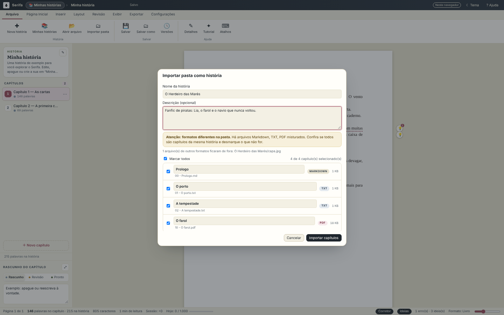
  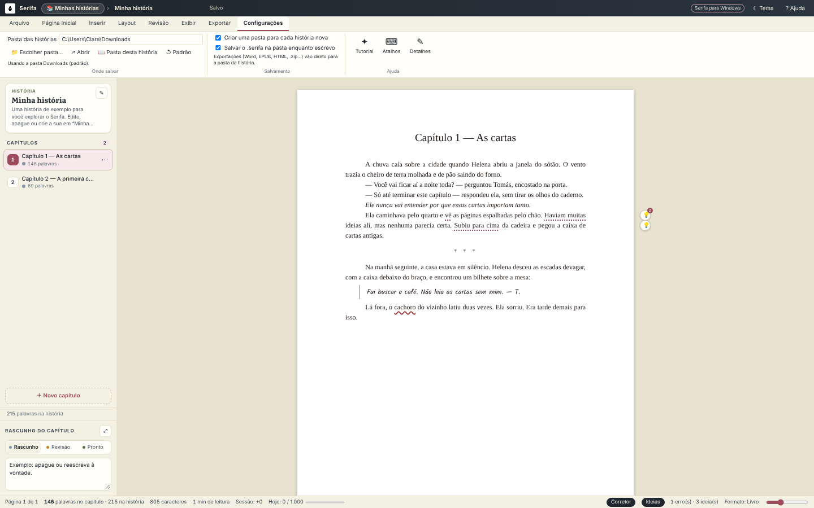
</p>

<p align="center">
  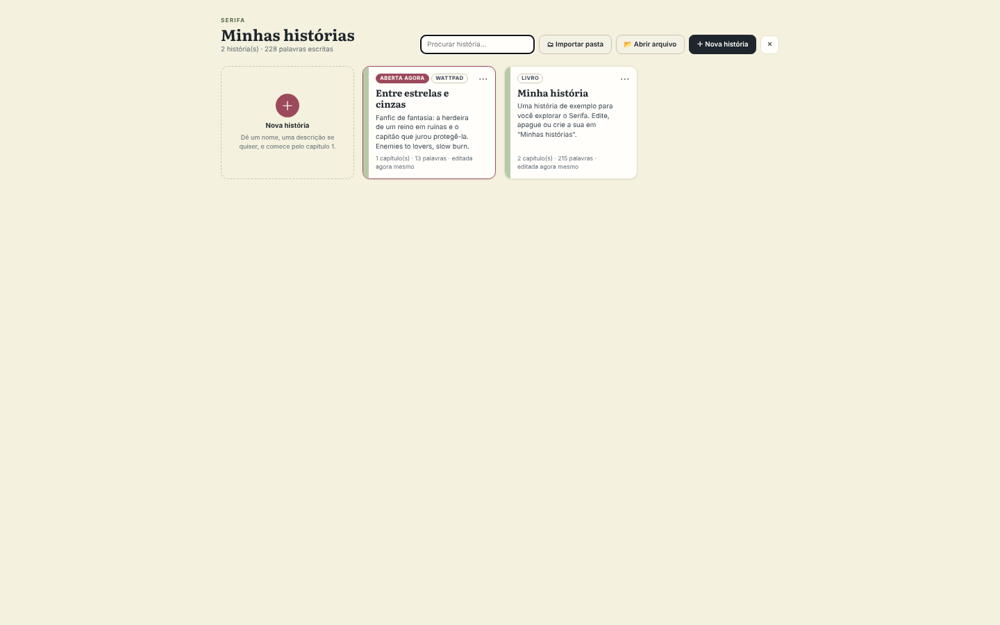
  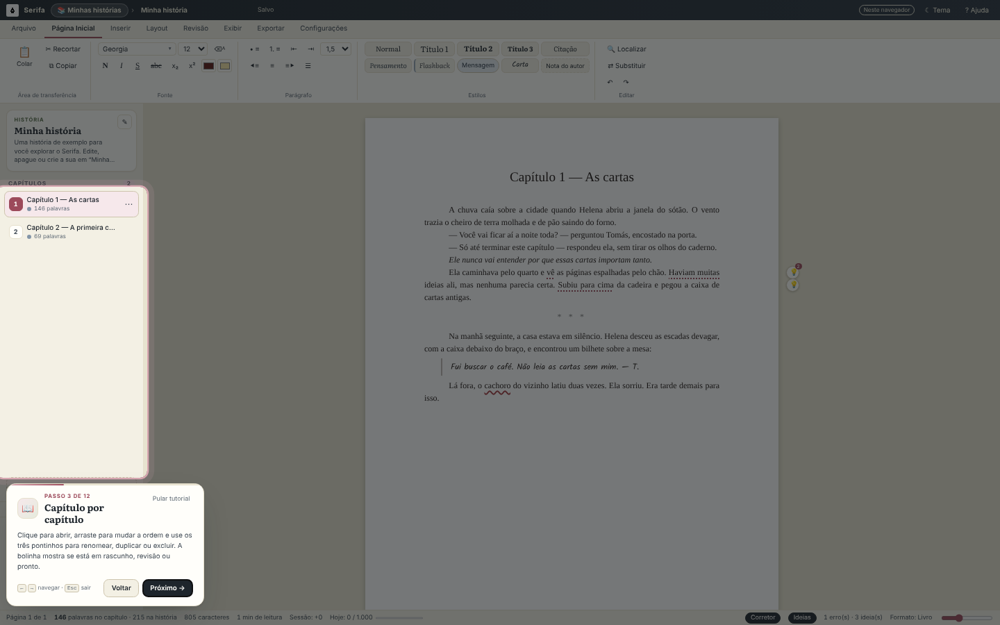
</p>

<p align="center">
  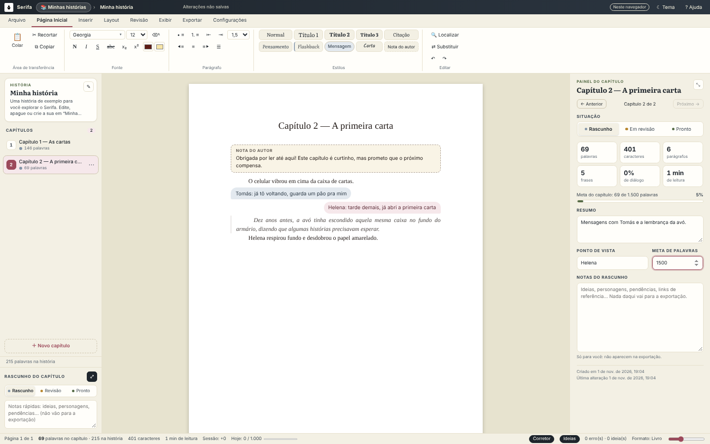
  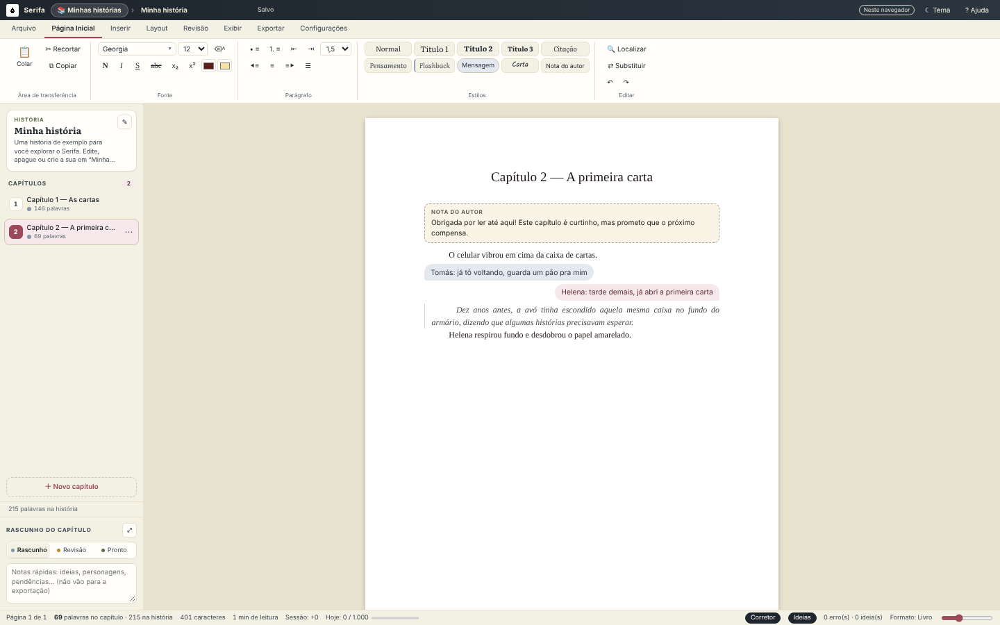
</p>

<p align="center">
  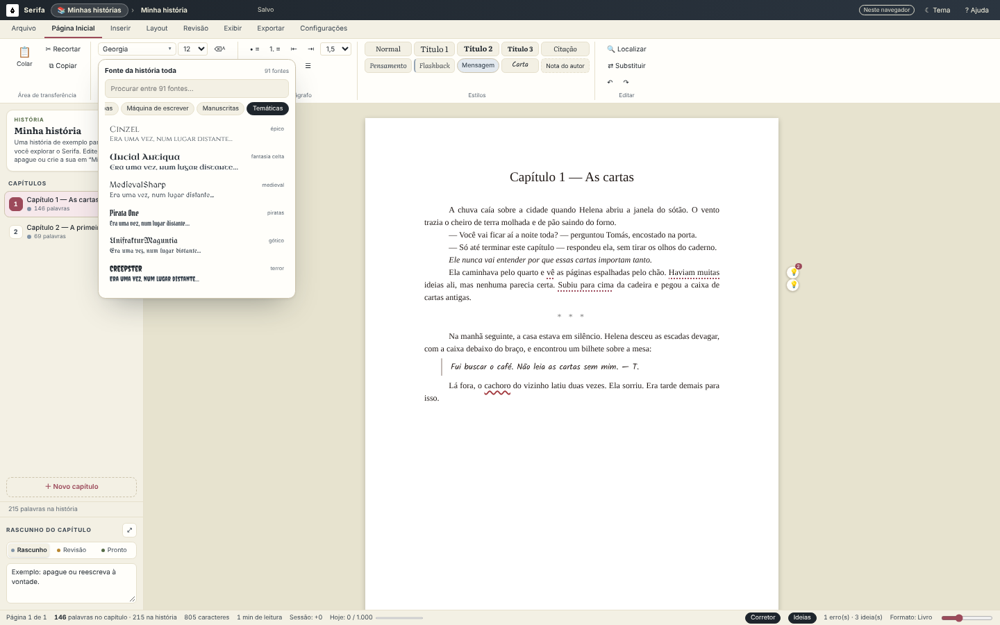
  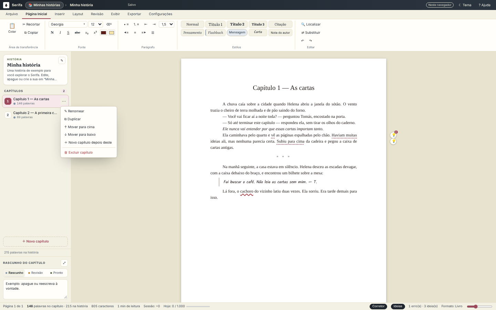
</p>

<p align="center">
  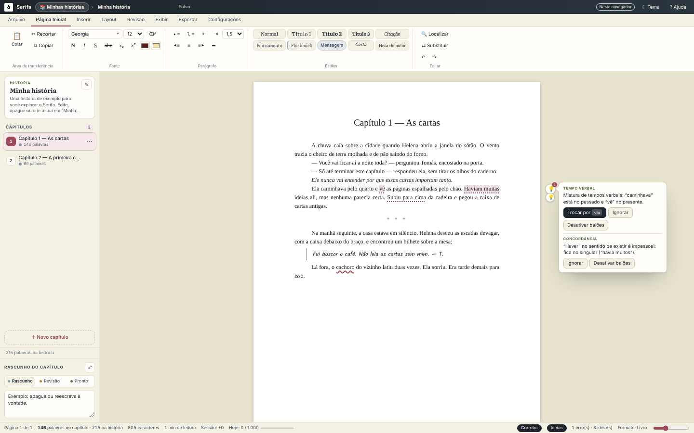
  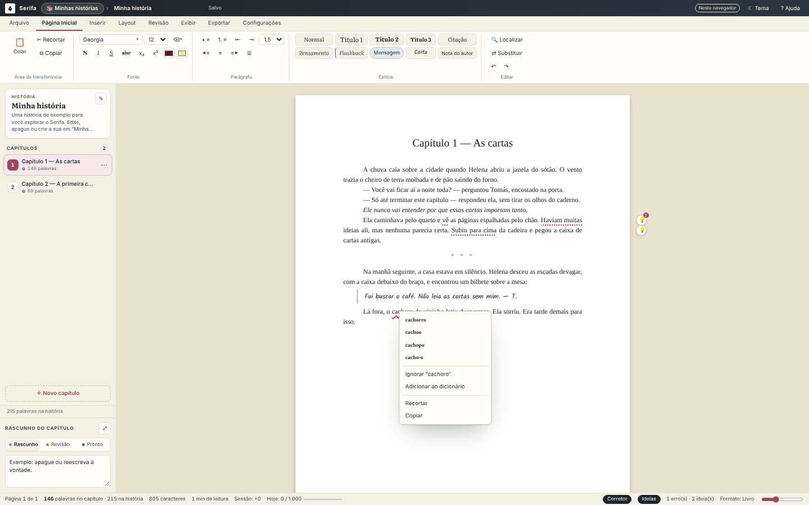
</p>

<p align="center">
  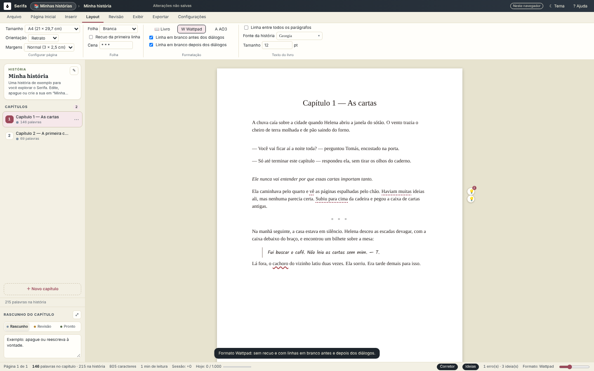
  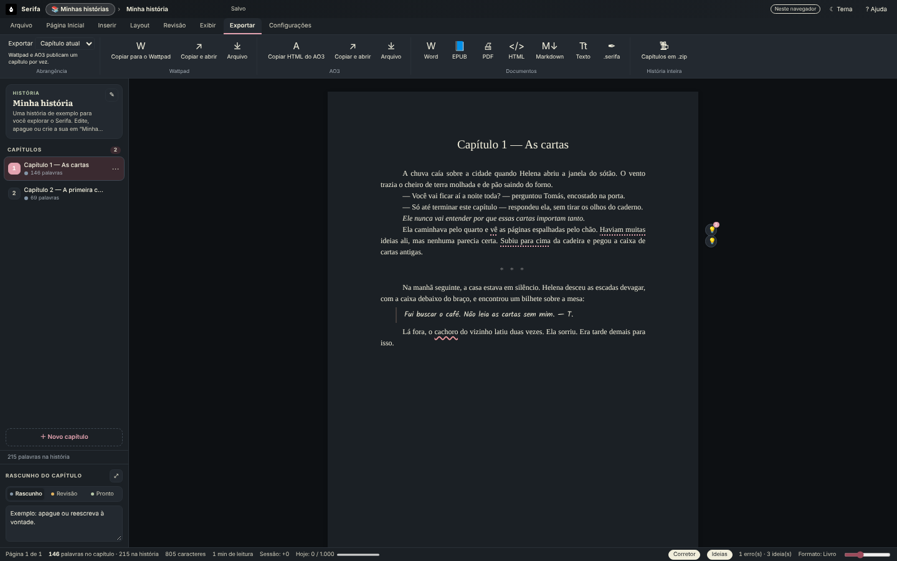
</p>

<p align="center">
  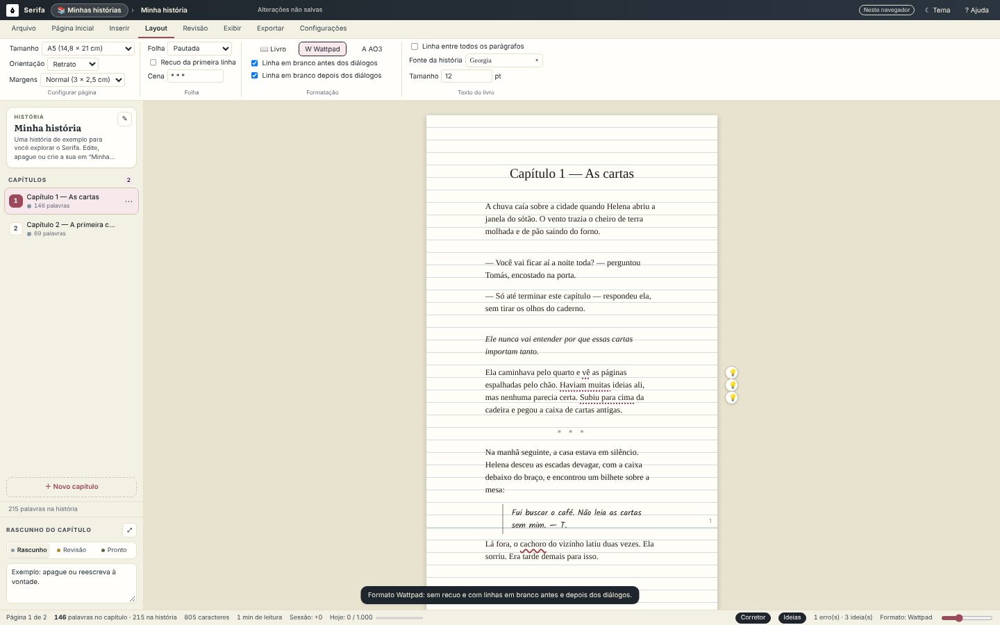
  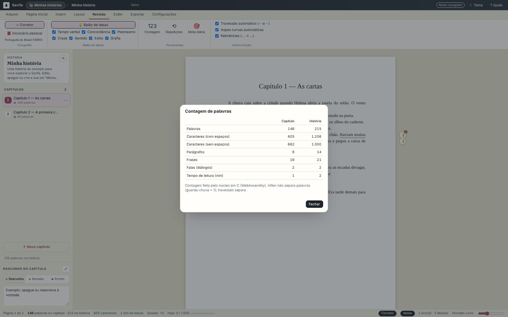
</p>

## Publicar no Wattpad e no AO3

| Formato | Recuo | Entre parágrafos | Antes do diálogo | Depois do diálogo | Quebra de cena |
|---|---|---|---|---|---|
| **Livro** | 1,25 cm | Sem espaço | — | — | `* * *` centralizado |
| **Wattpad** | Sem recuo | Espaço do Wattpad | Linha em branco | Linha em branco | `* * *` centralizado |
| **AO3** | Sem recuo | Espaço do AO3 | Linha em branco | — | `<hr />` |

1. **Wattpad:** escreva o capítulo, vá em **Exportar → Copiar para o Wattpad** (ou **Copiar e abrir**, que já abre o Wattpad), crie a parte nova da história, coloque o título no campo de título e cole o texto com **Ctrl+V**. Negrito, itálico, sublinhado, alinhamento e as linhas em branco vão junto.
2. **AO3:** vá em **Exportar → Copiar HTML do AO3**, abra **Post New Work**, troque o campo **Work Text** para **HTML** e cole com **Ctrl+V**. O título do capítulo vai no campo próprio do AO3.

A saída de cada formato é a mesma no navegador e no servidor Java, conferida pelos casos de [`tests/fixtures/exportacao.json`](tests/fixtures).

## Atalhos

| Atalho | Ação | Atalho | Ação |
|---|---|---|---|
| `Ctrl+S` | Salvar | `Ctrl+Shift+S` | Salvar como… |
| `Ctrl+O` | Minhas histórias | `Ctrl+N` | Novo capítulo |
| `Ctrl+B` / `I` / `U` | Negrito, itálico, sublinhado | `Ctrl+E` / `L` / `R` / `J` | Centralizar, esquerda, direita, justificar |
| `Ctrl+0` | Estilo Normal | `Ctrl+Alt+1` / `2` / `3` | Título 1, 2 e 3 |
| `Ctrl+Alt+4` / `5` / `6` | Pensamento, Flashback, Mensagem | `Ctrl+Alt+7` / `8` | Carta, Nota do autor |
| `Ctrl+Enter` | Quebra de página | `Ctrl+Shift+Enter` | Quebra de cena |
| `Ctrl+F` / `Ctrl+H` | Localizar / substituir | `Ctrl+Z` / `Ctrl+Y` | Desfazer / refazer |
| `F7` | Liga e desliga o corretor | `Shift+F7` | Liga e desliga o balão de ideias |
| `F11` | Modo foco | `Ctrl+Shift+D` | Tema claro ou escuro |
| `Ctrl+=` / `Ctrl+-` | Zoom | Botão direito | Sugestões do corretor e das ideias |
| `Esc` | Fecha Minhas histórias, o painel do capítulo ou o tutorial | `←` / `→` | Passos do tutorial |

## Arquitetura

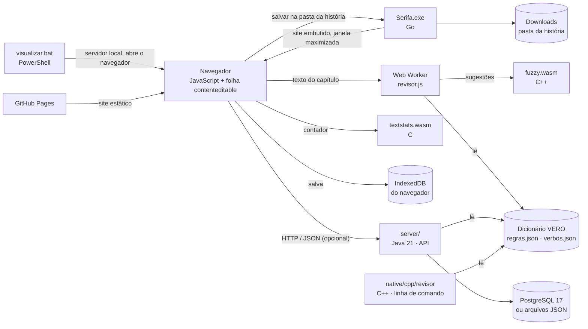

| Parte | Linguagem | Responsabilidade |
|---|---|---|
| `server/` | Java 21 (só o JDK) | API REST (`com.sun.net.httpserver`), validação, armazenamento em arquivos JSON com gravação atômica ou em PostgreSQL por JDBC, revisões, motor de revisão (o mesmo corretor "hunspell-lite" e as mesmas ideias do navegador), exportação Wattpad, AO3, texto, Markdown, HTML, DOCX e EPUB, cabeçalhos de segurança e linha de comando |
| `web/js/core` | JavaScript | Núcleo sem DOM: contagem (`texto.js`), leitor e sanitizador de HTML (`html.js`), corretor (`ortografia.js`), ideias (`ideias.js`), exportação (`exportar.js`) e ZIP (`zip.js`) |
| `web/js/ui` e `web/js/workers` | JavaScript | Faixa de opções, folha, Minhas histórias, capítulos, painel do capítulo, seletor de fontes (`fontes.js`), tutorial (`tutorial.js`), destaques com a CSS Custom Highlight API, lâmpadas e balões, menu de contexto, localizar e substituir, diálogos, IndexedDB (`storage.js`) e o worker da revisão |
| `native/c` | C | Contador de palavras sem libc, compilado para `web/wasm/textstats.wasm`, e o `contar` de linha de comando |
| `native/cpp` | C++ | Distância Damerau-Levenshtein ponderada para ordenar sugestões (`web/wasm/fuzzy.wasm`) e o `revisor`, que revisa arquivos de texto inteiros pela linha de comando |
| `web/dados` | JSON | Regras do balão de ideias e conjugações, lidas igual pelo JavaScript e pelo Java |
| `desktop/` e `Serifa.exe` | Go | Versão para Windows: servidor local com o site embutido, janela do Edge em modo aplicativo maximizada, pasta de cada história em Downloads, configurações em `%AppData%\Serifa` |
| `visualizar.bat` | Batch + PowerShell | Servidor estático local (só `localhost`, só leitura, sem sair da pasta `web/`) que abre o navegador |

### Como a revisão funciona

O dicionário VERO vem do Hunspell: cada palavra-base tem letras que dizem quais prefixos e sufixos aceita (`cachorro/B` aceita "cachorros"). Em vez de expandir tudo (seriam milhões de formas), o Serifa desfaz os afixos na hora de conferir: para "escrevêramos", procura sufixos que terminam a palavra, recoloca o que eles tiram, testa a condição e vê se o radical existe com a letra certa. O índice dos afixos pelo final da palavra deixa cada consulta em microssegundos. As sugestões vêm da tabela de erros comuns do próprio VERO, das trocas de acento e de uma edição (tirar, pôr, trocar ou inverter letras), ordenadas pela distância ponderada do `fuzzy.wasm`.

As ideias de tempo verbal usam a tabela de conjugações de `verbos.json` (presente, pretérito perfeito e imperfeito de cerca de 300 verbos): formas que também são substantivos comuns ("olho", "volta", "conta") e formas iguais em dois tempos ("andamos") ficam de fora, para o balão só aparecer quando a mistura de tempos é clara.

## Como rodar

| Maneira | Como abrir | Precisa de | Onde ficam os textos |
|---|---|---|---|
| **1. Navegador** | [violet-pixel.github.io/Fiction-Writing-Editor](https://violet-pixel.github.io/Fiction-Writing-Editor/) | Um navegador atual (Chrome, Edge, Firefox ou Safari) | No navegador (IndexedDB) |
| **2. `visualizar.bat`** | Dois cliques no `visualizar.bat` (Windows) | Windows 10 ou 11; nada para instalar | No navegador (IndexedDB) |
| **3. Servidor Java** | `server/build.sh` (ou `build.cmd`) e `java -jar server/target/serifa.jar serve` | Java 21 | No navegador e no servidor (arquivos JSON ou PostgreSQL), com a API |
| **4. `Serifa.exe`** | Dois cliques no `Serifa.exe` (Windows) | Windows 10 ou 11 com o Edge (já vem no Windows) ou o Chrome | Numa pasta por história (Downloads, por padrão) e na janela do Serifa |

O `Serifa.exe` é um programa em Go com o site inteiro dentro dele: sobe um servidor só deste computador (`127.0.0.1:8840`) e abre o Edge em modo aplicativo, maximizado, sem barra de endereço. Na primeira vez, o SmartScreen pode avisar que o arquivo não é assinado: **Mais informações → Executar assim mesmo**.

O `visualizar.bat` sobe um servidor local pelo PowerShell em `http://localhost:8790` (ou na próxima porta livre) e abre o navegador; feche a janela preta para encerrar. Se a pasta `web/` não estiver ao lado dele, abre a versão online.

## Usando a API

Com o servidor Java rodando (`http://127.0.0.1:8080`):

```bash
curl http://127.0.0.1:8080/api/v1/health
curl -X POST http://127.0.0.1:8080/api/v1/count -H 'Content-Type: application/json' -d '{"text":"— Olá! Tudo bem?"}'
curl -X POST http://127.0.0.1:8080/api/v1/check -H 'Content-Type: application/json' -d '{"text":"Ela caminhava e vê o cachoro.","spelling":true,"ideas":true}'
curl -X POST http://127.0.0.1:8080/api/v1/export/ao3 -H 'Content-Type: application/json' --data @minha-historia.serifa
```

| Rota | O que faz |
|---|---|
| `GET /api/v1/health` | Estado e versão |
| `GET/POST /api/v1/projects` | Lista e cria projetos (documento `.serifa`) |
| `GET/PUT/DELETE /api/v1/projects/{id}` | Abre, salva (guarda uma revisão) e exclui |
| `GET /api/v1/projects/{id}/revisions` | Últimas 50 revisões |
| `POST /api/v1/count` | Estatísticas do texto |
| `POST /api/v1/check` | Ortografia e ideias, com offsets em UTF-16 |
| `POST /api/v1/export/{formato}` | `wattpad`, `ao3`, `txt`, `md`, `html`, `docx` ou `epub` (`?chapter=ID` para um capítulo) |

| Variável | Padrão | Para quê |
|---|---|---|
| `SERIFA_PORT` | `8080` | Porta do servidor |
| `SERIFA_DATA` | `./dados-servidor` | Pasta dos projetos em JSON |
| `SERIFA_WEB` | `./web` | Pasta do site, do dicionário e dos dados |
| `SERIFA_DB_URL`, `SERIFA_DB_USER`, `SERIFA_DB_PASSWORD` | — | PostgreSQL por JDBC (o driver vai no classpath) |

## Ferramentas em C e C++

```bash
scripts/build-wasm.sh                  # gera web/wasm/textstats.wasm (C) e web/wasm/fuzzy.wasm (C++)
scripts/build-native.sh                # gera native/build/contar e native/build/revisor (no Windows: scripts\build-native.cmd)
native/build/contar capitulo.txt       # palavras, caracteres, parágrafos, frases, falas e tempo de leitura
native/build/revisor capitulo.txt      # linha:coluna palavra → sugestões (--json, --pessoal, --contar)
```

## Formato `.serifa`

É um JSON com o nome da história, a descrição e o pseudônimo opcionais, as configurações de página e formatação, os capítulos (título, posição, HTML limpo com os estilos de texto, notas, resumo, ponto de vista, meta, situação, palavras e datas), o dicionário do projeto e as ideias ignoradas. O mesmo arquivo abre no navegador, no `visualizar.bat` e no servidor.

## Banco de dados

No servidor, o PostgreSQL guarda `projeto`, `capitulo`, `revisao`, `dicionario_pessoal`, `ideia_ignorada`, `sessao_escrita`, `exportacao` e `preferencia` (esquema em [`server/src/main/resources/db/schema.sql`](server/src/main/resources/db/schema.sql)). No navegador, o IndexedDB tem os object stores `projetos`, `capitulos`, `revisoes`, `dicionario`, `sessoes` e `preferencias`, que espelham as mesmas entidades. O detalhe de cada campo está no [`Banco-de-Dados-Serifa.pdf`](Banco-de-Dados-Serifa.pdf).

## Desenvolvimento e testes

```bash
npm test                         # testes do núcleo em JavaScript e dos dois .wasm (Node 20+), com as fixtures de paridade
bash server/test.sh              # testes do servidor e do motor em Java (no Windows: server\test.cmd)
bash native/tests/revisor-test.sh # revisor em C++ contra tests/fixtures/ortografia.json
scripts/build-wasm.sh            # recompila os .wasm depois de mudar native/
node scripts/build-pdfs.js       # gera os dois PDFs de novo
bash scripts/build-desktop.sh    # gera o Serifa.exe (Go 1.22+, compila de qualquer sistema)
```

Os mesmos casos de `tests/fixtures/` (contagem, ortografia, ideias e exportação) são conferidos pelo JavaScript, pelo Java, pelo C e pelo C++, para que o navegador, o servidor e as ferramentas deem sempre o mesmo resultado.

## Qualidade e segurança

- **Sanitização:** todo HTML colado, importado ou vindo de um `.serifa` passa por uma lista do que é permitido (blocos, formatação, links `http(s)` e imagens `data:`/`https:`); estilos só com propriedades conhecidas e sem `url()`; nada de `script`, `style`, eventos ou `javascript:`.
- **Content-Security-Policy:** a página só executa os próprios módulos e WebAssembly, só se conecta com a própria origem e não pode ser embutida em outras páginas.
- **Servidor Java:** escuta só em `127.0.0.1`, recusa corpos acima de 10 MB, valida todos os campos com mensagens em português, envia `Content-Security-Policy`, `X-Content-Type-Options`, `X-Frame-Options: DENY` e `Referrer-Policy`, e não deixa sair da pasta `web/` ao servir arquivos.
- **`visualizar.bat`:** só `localhost`, só `GET`, sem listar pastas e sem sair de `web/`.
- **Privacidade:** o Serifa não pede nome, e-mail nem conta; o pseudônimo do projeto é opcional.

### Estrutura

```text
Serifa.exe                  Serifa para Windows (gerado por scripts/build-desktop.sh)
desktop/                    código da versão para Windows em Go
visualizar.bat              abre o Serifa no Windows (servidor local pelo PowerShell)
web/                        o site (raiz do GitHub Pages)
  index.html, css/, img/
  fontes/                   77 fontes livres em WOFF2 (subconjunto latino) e LICENCAS.txt
  vendor/pdfjs/             pdf.js, para ler o texto dos PDFs importados
  js/core/                  núcleo em JavaScript, sem DOM, testado no Node
  js/ui/                    interface: faixa de opções, folha, capítulos, diálogos e armazenamento
  js/workers/               worker da revisão
  dicionario/               dicionário VERO (pt-BR) do Hunspell, sem modificação
  dados/                    regras do balão de ideias e conjugações
  wasm/                     textstats.wasm (C) e fuzzy.wasm (C++)
server/                     servidor, API, motor e linha de comando em Java 21
native/c/, native/cpp/      contador (C), distância de edição e revisor (C++)
tests/fixtures/             casos de paridade entre JavaScript, Java, C e C++
tests/js/, native/tests/    testes em Node
scripts/                    build dos .wasm, das ferramentas nativas e dos PDFs
docs/                       manuais em PDF e imagens do README
.github/workflows/          CI (testes em JS, Java, C e C++) e publicação no GitHub Pages
```

### Componentes de terceiros

| Componente | Uso no projeto | Licença |
|---|---|---|
| [VERO, dicionário pt-BR do Hunspell](https://github.com/LibreOffice/dictionaries/tree/master/pt_BR) | Corretor ortográfico (`web/dicionario/`, sem modificação) | LGPL-3.0 ou MPL ([`LICENSE-VERO.txt`](web/dicionario/LICENSE-VERO.txt)) |
| [Fontes do Google Fonts via Fontsource](https://fontsource.org/) | 77 fontes de texto embutidas (`web/fontes/`, lista em [`LICENCAS.txt`](web/fontes/LICENCAS.txt)) | SIL Open Font License 1.1 (73) e Apache-2.0 (4) |
| [pdf.js](https://mozilla.github.io/pdf.js/) 4.10 | Ler o texto dos PDFs na importação de pasta (`web/vendor/pdfjs/`, carregado só quando há PDF) | Apache-2.0 ([`LICENSE`](web/vendor/pdfjs/LICENSE)) |
| [Playwright](https://playwright.dev/) | Capturas de tela e PDFs (só no desenvolvimento) | Apache-2.0 |

Fora o pdf.js, o editor não usa bibliotecas externas: as fontes ficam dentro do próprio site (nada é baixado de outro servidor), a interface usa as fontes do sistema e os ícones são caracteres Unicode. Wattpad e AO3 (Archive of Our Own) são marcas dos seus donos e aparecem aqui só para indicar os formatos de exportação.

## Licença

Copyright (©) 2026 Clara Portes ([Violet-pixel](https://github.com/Violet-pixel)). Todos os direitos reservados.

O Serifa é distribuído sob uma [licença de uso](LICENSE) própria:

| Pode | Não pode |
|---|---|
| Usar de graça, no navegador, pelo `visualizar.bat` ou com o servidor Java | Modificar o Serifa ou criar versões derivadas |
| Configurar pelas variáveis do servidor e pelas preferências do editor | Copiar o código, no todo ou em parte, para outros projetos |
| Usar e publicar como quiser o que você escreve, inclusive comercialmente | Redistribuir, publicar ou vender o Serifa |

Para pedir uma autorização que a licença não dá, fale com a autora, Clara Portes, pelo [GitHub](https://github.com/Violet-pixel). O texto completo está em [`LICENSE`](LICENSE).
